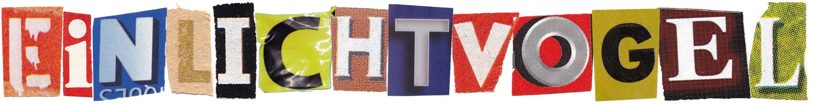

    

# 👋 Hey there, I'm Luca! 

🚀 **Freelancer | Lighting Technician | Developer**  
🌍 **Based in Bavaria, Germany**  
💡 **Passionate about tech, automation, and making things work seamlessly!**  

## 🔥 About Me  
By day, I hobby as a **lighting technician**, making events shine. By night, I'm deep into code, bringing ideas to life. Whether it's scripting automation, diving into backend development, or tinkering with new frameworks, I'm always exploring!

💻 **Main Stacks:**  
- **Frontend:** Vue.js, Swift, JavaScript, TypeScript  
- **Backend:** Node.js NestJS, Firebase, PostgreSQL, MySQL  
- **Systems:** Linux, Raspberry Pi, Mac, Windows
- **Random:** Docker, Git, GitHub, GitLab, Unity

📚 **Currently Learning:** MA Lighting GrandMA3  
🎶 **Hobbies:** Coding, electronics, and exploring new tech  

## 🛠️ My Tools & Technologies  

## 📊 GitHub Stats  

📈 **My Activity:**  
  
🔥 **Top Languages:**  
  

## 🚀 Let's Connect!  
💬 **Want to chat about tech, lighting, or automation?**  
📫 Reach me via **[Matrix]([@luca.hess:it-media-hof.de](https://matrix.to/#/@luca.hess:it-media-hof.de))** or **[Mail](mailto:development@luca-hess.de)**

💡 *"Technology should either make life easier or more fun—preferably both!"*  
